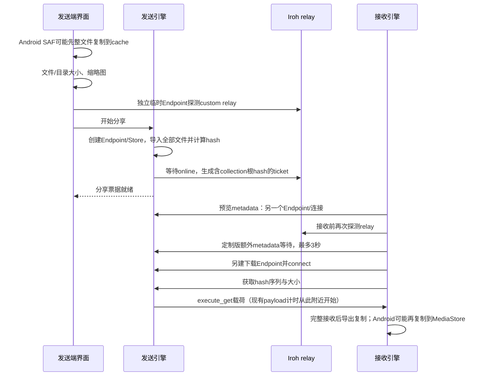

# DashBeam 分享与传输时延调研

调研日期：2026-11-10。作者：Codex。范围：源码、现场只读检查、隔离合成数据探针与方案设计。本轮没有修改客户端产品代码、安装包、生产 relay 配置或部署服务。

## 结论

当前的慢有两类：**分享/接收准备阶段等待很长**，以及**已经开始传输后的吞吐偏低或波动**。前一类有明确的源码结构和历史计时证据；后一类受路径、RTT、丢包、QUIC-over-TCP、流控与设备读写共同影响，本轮不能归结为唯一根因。

建议先消除每笔传输重复探测、独立 Endpoint、非必要元数据依赖和重试叠加；再在最新原版上新增无需全文件预哈希的流式会话。直连探测与可用中继并行，哪条认证路径先可用就开始传，不等“确认打洞失败”。可选的服务器**硬盘密文滑动缓存**用来吸收收发速率差、支持断线恢复。它不是开始传输的前置条件，也不是把 QUIC 包队列写到硬盘。

3 秒可以作为有前提、需实际验证的首个认证载荷 SLO，不能作为任意网络、手机后台、任意文件提供器和人工选设备/确认操作都在内的保证。新流程与验收见 [最新上游设计](UPSTREAM_DESIGN.md)，具体设计审查见 [对抗审查](ADVERSARIAL_REVIEW.md)。

## 1. 固定版本，避免混用结论

| 对象 | 本轮核验版本 | 结论适用范围 |
| --- | --- | --- |
| 本地定制源码 | `local/macos-integration`，`f3253bbbf6c1028821e2a66602ede9557cff4113` | 当前定制实现，Iroh 1.0.3 / Blobs 0.103.0 |
| 本机应用 | `/Applications/DashBeam.app`，build 70104 | 安装信息及本机历史；未以此做手机实时收发验收 |
| 最新原作者 main | [b41eddb16b226667de6f8dd7f1326a0ce6bf5e7d](https://github.com/tonyantony300/dashbeam/commit/b41eddb16b226667de6f8dd7f1326a0ce6bf5e7d)，提交时间 2026-10-19 | 新方案的唯一原版基线；Iroh/relay 1.3.0、Blobs 0.103.1、Noq-proto 1.3.0 |
| 最新原作者 Release | [v0.7.2](https://github.com/tonyantony300/dashbeam/releases/tag/v0.7.2)，2026-10-14 | Release target 为 `9f2dfaf99caee335a5dd9979e0baba24fd2d9c50`，并非最新 main |
| 自托管 GZ / SH relay | 运行中二进制分别 1.4.0 / 1.0.0 | 二者真实数据探针均通过；版本差异本身不等于不兼容 |

原作者隔离 checkout：`/Users/luoji12103/Codex/dashbeam-upstream-audit-20261110`。本轮 DEV 探针来自定制版旧栈，不是新版性能测试。原作者仓库保持干净。

## 2. 当前流程为什么会等

这张图描述实际可能发生的阶段，不表示每次都会触发全部预览/重试。metadata 的定制接收前置等待不在最新原版中。

### 2.1 全量预处理挡在分享之前

- 定制版 `src-tauri/src/commands.rs:285` 起，元数据、缩略图和目录统计先于 relay probe 与分享调用。
- 最新原版同样如此：`commands.rs:238-273`、`:320-346`；即使目录统计用了 blocking worker，调用方仍等待结果才向后走。
- `engine/native/src/send.rs:89-108` 等待 `import_paths` 完成；`import.rs` 遍历并导入全部文件，得到内容摘要与 collection 根。
- 原版 `engine/protocol/src/send.rs:198-216` 注册路由、等待 online，再构造含根 hash 的 `BlobTicket(HashSeq)`。因此只把哈希任务放后台，仍使用相同 ticket，不能让真正文件数据在根 hash 生成前开始传。
- Android 的 `CopyUtils.kt` / `NativeUtils.kt` 选取路径会先将 URI 内容复制到 cache，多 URI 串行处理。大文件可能先完整读一次，再导入/哈希。文件提供器还可能需要从云端取回数据。

目录遍历主要随文件数增长，预哈希与复制主要随总字节数增长，二者必须分别测量。DEV 的热页缓存成绩不能证明手机大文件准备耗时很小。

### 2.2 连接与预览重复做

- 常驻 node、预览 metadata、分享、下载不是天然同一个数据会话。原版虽有 `run_share_on_endpoint` helper，主流程没有接入，常驻 router 当前只注册 CONTROL_ALPN。
- 接收方每笔 custom relay probe 和临时 bind 会消耗 DNS/TLS/鉴权/在线等待；probe 成功只说明探针连上至少一个 relay。
- 当前定制版为了文字类型增加了接收前独立 metadata 请求，最多等 3 秒；随后仍另外建下载连接。最新原版 `commands.rs:492-567` 不存在此 gate，不能把它算成原版问题。
- 在 QUIC `open_bi` 后，对端须收到首写才能看见该流。旧 metadata 的 1-byte marker 不能机械删除；新协议应以有意义的 OPEN 首帧替代。
- 同一长期 EndpointId 不应被多个独立 Endpoint 同时拥有。新版 relay 会替换 active 连接并将旧连接置 inactive，而不是简单拒绝；这仍可能引发会话争用，需要单一 Endpoint 生命周期管理。

### 2.3 重试掩盖了实际等待

当前定制版 `engine/protocol/src/receive.rs:35-83` 的 connect 为 3 次、每次 10 秒，外层下载再尝试 3 次；固定等待叠加约 93 秒，算上准备与 metadata 可以接近 96 秒。它提高了短暂故障后成功的机会，但没有修复地址陈旧、发送端不在线或实际路径建立失败。

最新原版 `engine/protocol/src/receive.rs:137-153` 只有一次 connect，不含这一层定制重试；预览 metadata 另有自己的多阶段超时。新方案要使用统一截止时间与可观测状态，不再套多层完整重试。

### 2.4 地址与配置存在恢复缺口

本轮源码复核支持以下风险，但尚不能逐一认定为手机某笔故障的根因：

- startup 先使用公共默认 relay/discovery；前端一次性 DeviceNodeSync 没等待持久化设置 hydration，存在同步早于配置恢复的竞态。
- paired 数据写入远端 home relay 时使用本机 home，可能使 control/invite 使用错误或陈旧的提示。
- ticket 只要带任意 relay/IP，接收构建就不安装 discovery lookup。已有地址失效时缺少再次发现的恢复手段。最新原版 `engine/native/src/receive.rs:42-58` 仍有此条件。
- 配置中列有两台 relay，不代表两台均已鉴权、发送方在目标 relay 在线，或这笔数据流实际走了它们。

## 3. 打洞和中继实际如何工作

Iroh 的 relay 负责可达性与数据转发，discovery 提供 EndpointId 的地址提示。客户端拥有私钥和端到端 QUIC 连接；relay 不是拿到分享信号后替手机完成 UDP 打洞的文件服务器。

可先通过 relay 建立端到端连接，同时探测直连路径，直连可用后迁移。**不需要先等待打洞失败，才允许中继传第一字节。** 不同 home relay 是协议支持的情形，无需强制搭建 GZ↔SH relay mesh。接收者访问发送者的 relay URL 时，自托管鉴权配置必须在它自己的 RelayMap 中正确匹配。

几十毫秒可描述部分已在线、低 RTT 场景的建连，不能覆盖 DNS、TCP/TLS、鉴权、地址发现、移动网络 NAT、丢包和系统调度。`Endpoint::online()` 确实等待 home relay 连接成功；旧源码中其他测试附近的注释不能替代实现语义。

当前旧栈 native relay 使用 TLS/TCP 上的 WebSocket，承载端到端 QUIC 数据。TCP 丢包与有序交付会产生队头阻塞；外层和内层拥塞/恢复叠加，不应把 relay 当作无损局域网。

旧栈 Noq-proto 1.1.0 默认单 stream 接收窗 1,250,000 B、发送窗 10,000,000 B，默认 Cubic；Iroh wrapper 没有将其覆盖为无限窗口。另已核验与最新锁文件checksum一致的官方 Noq-proto 1.3.0 / Iroh 1.3.0 crate：这些默认值相同，connection receive_window 为 VarInt::MAX，产品未见覆盖。证据见 [Noq 对应提交 transport.rs:548](https://github.com/n0-computer/noq/blob/c1f411562e6078852749b8bcf1190523096a107f/noq-proto/src/config/transport.rs#L548) 与 Iroh `src/endpoint/quic.rs:140-163`。`W/RTT` 只能提示可能的流控天花板，不是本次 26–39 Mbps 的唯一解释；新版仍须真实网络A/B后再调参。

Relay 默认有界队列为 512 **条目**，不是 512 MB，也不是文件缓存。队列满可能丢包。`max_burst_bytes` 是速率令牌桶的突发额度，不是可可靠交付的数据暂存。FsStore 的 iRPC 是本机消息接口，不是额外一跳远程 gRPC。

## 4. 本轮测到了什么

所有探针用合成内容和临时随机身份。重编译放在 Debian13 DEV 独立实验目录；没有覆盖 DEV 原有脏源码。本机只做轻量 Node relay 测量。没有采集用户文件名、完整 ticket 或 token。

### 4.1 历史记录：小文件也能在数据阶段之外等几十秒

只读本机 `transfer-history.json` 的脱敏汇总，时间为 UTC：

| 样本 | 内容大小 | 历史记录总时长 | payload计时 | 导出计时 | 未包含在后二者的差值 |
| --- | ---: | ---: | ---: | ---: | ---: |
| 2026-11-09 07:43:13，completed | 1,499,219 B | 45.416 s | 3.253 s | 0.017 s | 42.146 s |
| 2026-10-18，completed | 747,597 B | 32.161 s | 0.594 s | 0.014 s | 31.553 s |

差值说明旧 payload duration 不能代表用户总等待，不能精确证明 42 秒全是打洞或某个 probe。历史行开始前的前端准备还可能未被包含。10/18 的多笔 0 B 超时约 96.346 秒，与叠加重试结构吻合；11/10 的两条 0 B 记录是 cancelled（79.885 / 5.739 秒），不当成自动网络故障证据。也存在成功很快的记录。

### 4.2 Mac 到单 relay：鉴权和 RTT

原始记录：[mac-relay.json](mac-relay.json)，2026-11-10 08:52 UTC。Node 原生 TLS API、WebSocket 101、relay-v2、鉴权成功，每台 8 个 ping。**没有文件 QUIC，也不代表手机→Mac 逐笔路径。**

| 目标 | TLS ready | 完整鉴权 ready | RTT最小 / 中位 / 最大 |
| --- | ---: | ---: | ---: |
| GZ | 1,144.8 ms | 1,559.4 ms | 334.5 / 377.6 / 1,325.8 ms |
| SH | 268.8 ms | 366.9 ms | 49.9 / 103.3 / 395.9 ms |

这次从 Mac 访问 GZ 比 SH 慢且波动大，支持优先复用连接、实测选路；不能据此认定 GZ CPU/内存不足，或把永久固定 SH 当成所有网络的最优解。

### 4.3 DEV 分享准备与直连

原始记录：[dev-share.jsonl](dev-share.jsonl)。旧栈 debug engine-only、关闭 relay、合成文件刚写入页缓存；每种 3 次，不是冷盘/移动设备/release 吞吐基准。

| 输入 | share_prepare 中位数 |
| --- | ---: |
| 1 MiB单文件 | 25.44 ms |
| 64 MiB单文件 | 65.35 ms |
| 256 MiB单文件 | 220.57 ms |
| 256个4 KiB文件，总1 MiB | 85.01 ms |

同机 64 MiB engine 直连：准备 80.10 ms；首次非零进度事件距分享起点 167.81 ms；完成事件 1,393.97 ms；payload_get 1,223 ms；导出 42 ms，输出逐字节一致。**进度事件是代理指标，不是首个真实载荷字节。** 初版实验 harness 曾重复 shutdown store 导致 Senderclosed，已修复；这不是产品故障。

### 4.4 强制 relay 的实际 QUIC 载荷

原始记录：[dev-relay-optimized.jsonl](dev-relay-optimized.jsonl)。Iroh 1.0.3、release opt-level=2、无 LTO、8 codegen units；通过 `clear_ip_transports()` 禁用直连，路径 watcher 核验两端使用 relay。双方物理上都位于 DEV，不是两地手机/Mac。每 case 两个顺序 16 MiB stream，逐字节验证、收到后 ACK、清理成功；不是稳态极限带宽测试。

| 场景 | 等待online约值 | QUIC connect | 从connect起首应用payload | 两个stream Mbps，含ACK |
| --- | ---: | ---: | ---: | ---: |
| 同GZ | 373 / 422 ms | 34.06 ms | 43.76 ms | 26.47 / 34.28 |
| 同SH | 533 / 560 ms | 147.99 ms | 193.97 ms | 27.52 / 39.09 |
| 初始home分别GZ/SH，接收者补入GZ配置 | 347 / 496 ms | 96.88 ms | 109.74 ms | 37.61 / 38.24 |

第三种的起始和插入配置后 home 确实不同；实际数据走 GZ，结束时接收端 home 已迁到 GZ。因此只能证明“初始 home 不同本身不会必然卡死”，不能声称全程保持不同 home，更不能替代手机发送到 Mac 的验收。JSON 第二个 first_payload 值仍从最初 connect 起算，表中只用第一个。

[dev-relay.json](dev-relay.json) 是更早的 debug 探针，约 33 Mbps；保留供复核，不与 release 成绩合成统计分位数。

### 4.5 服务器与实际网络快照

- GZ/SH relay 客户端 rx 限额均为 12,500,000 B/s（约 100 Mbps），突发 25,000,000 B。即使云产品标称 200M，也不能直接把单连接期望定为 200 Mbps。
- 两端速率限制计数测试前后为 0、drop 累计不变，不能排除外部丢包、反压和其他队列。
- GZ/SH 采样时 relay RSS 约 7/27 MiB，CPU 低；不是峰值能力证明。GZ 可用内存约 166 MiB，SH 约 859 MiB，但**硬盘缓存并不要求占用1 GB内存**。
- GZ/SH 根盘当时空闲约 20/28 GB。须另设系统预留量，不能把这些全部当 spool 容量。
- 443 分别经 HAProxy / nginx stream SNI 透传到 relay 34443，connect timeout 10 秒、连接 timeout 1 小时。未修改。
- 本机有效配置仍为双 custom relay + strict + 自建 discovery。Clash 快照见 DashBeam 公共 discovery/relay 的 TCP 走 HK-DMIT-HY2，另有 UDP DIRECT；只证明那些连接，不证明某笔 blob 路径。应用未显式调用 relay 的 `proxy_from_env()`，仍可能受透明代理影响。

### 4.6 新流程机制原型：真实HTTP、硬盘与认证帧

用户追加要求后，已在DEV用真实回环HTTP请求运行磁盘滑窗原型，详见 [实验说明](DISK_SPOOL_EXPERIMENT.md) 与 [原始数据](disk-spool.jsonl)。32 MiB文件首认证帧7.37 ms，完成840.03 ms；接收者人为限4 MiB/s时首帧6.13 ms、完成8,006.27 ms，帧文件块峰值6,684,672 B，不超过20%帧预算6,710,886 B，406次credit反压，全部内容校验一致。首帧不等全文件hash，也不等20%缓存填满。

这是单轮机制验证，非公网成绩或p95。预算只覆盖帧数据块，未包括目录/日志等完整服务开销；数据sync也没有一致性journal和重启恢复，不能称完整spool已验收。原型证明边读边传、边写盘边转发与有界反压能够同时成立。最新Iroh实际连接实验另见 [流式请求实验](SIMULATION.md)。

### 4.7 最新Iroh 1.3.0：真实流式请求、冷/热连接和公网中继

用户要求模拟真实请求后，另在DEV构建独立Iroh 1.3.0原型：OPEN最小信息→自动ACCEPT→从真实磁盘边读边hash边发→最终manifest/EOF→内容校验，使用新实验ALPN，不借用现有BlobTicket。最终版24次直连与8次强制SH relay传输全部成功，双方身份、实际路径、长度/摘要/EOF和输出重读均通过。详见 [完整实验](SIMULATION.md)、[依赖锁](streaming-request-Cargo.lock) 及原始JSONL。

64 MiB文件，从本次SendIntent开始：

| 场景 | 首帧配置 | 首实际文件字节 | 发送端首完整帧确认 | 全部完成确认 |
| --- | ---: | ---: | ---: | ---: |
| DEV同机直连，冷连接，n=3中位 | 64 KiB | 56.58 ms | 61.73 ms | 1,195.84 ms |
| DEV同机直连，复用连接，n=3中位 | 64 KiB | 14.99 ms | 17.01 ms | 1,368.53 ms |
| 强制SH relay，冷连接，n=1 | 64 KiB | 896.95 ms | 1,205.64 ms | 15,451.12 ms |
| 强制SH relay，复用连接，n=1 | 64 KiB | 161.70 ms | 283.85 ms | 14,476.86 ms |
| 强制SH relay，冷连接，n=1 | 首8 KiB，后64 KiB | 895.07 ms | 994.87 ms | 15,485.01 ms |
| 强制SH relay，复用连接，n=1 | 首8 KiB，后64 KiB | 150.79 ms | 258.86 ms | 13,855.08 ms |

同样64 KiB首帧下，直连冷连接的1 MiB/64 MiB首字节中位55.91/56.58 ms，内容大小增加64倍不再迫使先完整读/hash才能开始。relay模式明确禁用IP transport并核验两端路径；实际流量经过现有SH服务，但双方物理位置仍在同一DEV，非手机→Mac。

这组结果支持“重用连接+最小请求+无全量预hash”可把实验路径启动压到较小值。首8 KiB在这一次relay冷启动的完整帧确认上更快，但其他热样本有反向结果，不能宣布它在所有网络最优。顺序、少量样本也不足以证明因果或p95；设计保留8/16/64 KiB交错A/B。

**边界：**原型使用QUIC身份认证/加密，尚未实现设计的应用层AEAD及签名授权。接收只flush、未fsync，最终确认不是生产durable receipt。无UI、手机SAF/后台、人工选择/同意或产品完整导出链路。它不能证明已安装客户端达到该成绩，也不能与45秒历史样本直接构成同条件加速比。bulk完成仍约35–39 Mbps量级，启动改善不等于吞吐瓶颈已经解决。

## 5. 用户提出的硬盘缓存：可以做，应该放在哪里

定义 `F` 为本次传输全部选定文件的逻辑总大小，`C = min(floor(0.20 × F), 1,000,000,000 B)`。本报告按十进制 1 GB；实现时必须明示单位与边界。它是最大在途磁盘窗口，**首帧到达即可转发，不等攒满20%**。

推荐新增应用层密文 spool 服务：

现有 relay 盲转端到端 QUIC 包，无法代替真正接收端确认和推进它的接收窗口。把包写盘不会自动实现可恢复、发送方离线后继续交付的服务。新 spool 的两条客户端连接独立流控，服务端只持密文，文件密钥只给经认证的接收者，可以继续端到端加密。

磁盘段可取最大 4/8 MiB，网络认证帧取最大 64 KiB并支持更小帧；段未满也可转发/按时flush。若整个4 MiB只用一个末尾认证tag，1 Mbps 下首块可信明文要约33.6秒，违背低时延。64 KiB在1 Mbps下纯传输约0.52秒，仍需加握手/RTT/调度。AEAD、最终manifest、源一致性、续传与ACK规范见设计及审查。

当发送速率 `Bs > Br`，窗口填满时间近似 `t_full = C/(Bs-Br)`。10 GB文件、1 GB窗口、100 MB/s上行与20 MB/s下行，约12.5秒后填满，随后必须反压。接收端完全离线时，1 GB窗口不能让发送者退出后继续交付剩余9 GB。现有 FsStore 已支持部分本地续传；spool 解决的是额外的服务器暂存和两跳解耦能力。

还需全局/每用户/每传输配额、并发原子预订、磁盘和inode保留、超限反压、TTL、崩溃恢复、公平调度。upload durable ACK、接收端 durable ACK、缓存回收与最终交付状态必须分开。不能把内核写成功或收到网络ACK显示成“已可靠托管，可关闭发送端”。

## 6. 建议实施顺序

| 阶段 | 优先工作 | 验收标准 |
| --- | --- | --- |
| P0 可观测与路径正确性 | 全阶段trace；修复配置hydration、远端地址保存、陈旧地址恢复；消除重复probe和叠加retry | 任意失败能定位到准备/发现/鉴权/建连/首帧/传输/导出；明确实际路径；现有功能回归 |
| P1 最短在线链路 | 最新原版上单一Endpoint owner、新ALPN认证连接复用、小Offer/Accept、异步缩略图、无全量预哈希流式发送 | 大文件、Android SAF、目录能在约束条件下达到首认证载荷SLO；旧票据显式兼容 |
| P2 磁盘密文滑窗 | 独立应用服务、两跳credit、密钥与授权、durable ACK、quota、恢复 | 满盘/断线/重启/撤销/双路径重复/源变化故障注入通过；不会虚报可退出 |
| P3 吞吐与功耗 | 按实际版本调window/拥塞/并发；direct/relay、网络切换A/B；按状态预热/休眠 | 同时报告首载荷、完成、失败率、CPU/磁盘/电耗；不用峰值速度牺牲交互与稳定性 |

完整文件预哈希、SAF整文件暂存属于架构限制，P0修复不能声称解决了它。应先验证P1是否已足够，再承担P2的存储运维成本。缓存主要改善速率不匹配与恢复，不能降低物理RTT或凭空提高瓶颈带宽。

## 7. 尚未验证与下一轮测量

- 未重现某笔手机→Mac失败，未同时取得手机生命周期、两端逐阶段trace与实际数据路径，故不指认一个“唯一根因”。
- 未对最新原版完整客户端做端到端性能验收，也未实施产品新协议、完整spool或证明其SLO。当前成果是可审查设计及隔离机制原型；原型与完整客户端的验证边界分别列出。
- 下一轮按 warm/cold、同/异home、UDP可用/封锁、direct/relay、代理/直连、前台/后台、SAF本地/云/未知长度、小文件/大文件/多文件分层；失败和超时进入分母。
- 用单调时钟记录 SendIntent、最小元数据ready、Offer到达、Accept、连接ready、FirstAuthenticatedPayload、FinalVerified、ExportCommitted，双方用transfer_id关联；人工选择与接受的等待单列。不同设备的单调时钟不能直接相减：跨端指标以发送端起点至首帧确认回执作为保守上界，或明确做时钟同步与偏差估计；接收端本地 Accept→首认证帧单独报告。
- 新架构验证需要手机实机、Mac/Windows/Linux接收，以及服务端重启/满盘等故障注入。完成前不替换已安装版本。

## 8. 证据与复现材料

- 诊断源码：[share_start_probe.rs](share_start_probe.rs)、[relay_transport_probe.rs](relay_transport_probe.rs)、[mac_relay_probe.mjs](mac_relay_probe.mjs)。为临时实验入口，非产品代码；构建依赖与运行方法见各文件头/参数。relay鉴权需从受保护配置通过安全通道提供，不能写入命令行、报告或Git。
- DEV：`SER8-PVE-VM-102-Debian13-Dev`，隔离目录 `/home/luoji/code/dashbeam-receive-copy-20261109.tsjpxb`，复用既有target缓存；9个关键产品文件SHA256与当前定制仓库一致。原DEV脏工作区未覆盖。
- 官方概念：[relays](https://docs.iroh.computer/concepts/relays)、[NAT traversal](https://docs.iroh.computer/concepts/nat-traversal)、[QUIC flow control RFC9000 §4](https://www.rfc-editor.org/rfc/rfc9000.html#section-4)、[QUIC recovery RFC9002](https://www.rfc-editor.org/rfc/rfc9002.html)。概念文档不替代锁定版本源码和现场数据。
- [Iroh v1.3.0源码](https://github.com/n0-computer/iroh/tree/v1.3.0)、[Blobs v0.103.1](https://github.com/n0-computer/iroh-blobs/tree/v0.103.1)。设计的新安全/缓存协议不是现有Iroh relay自带能力。
